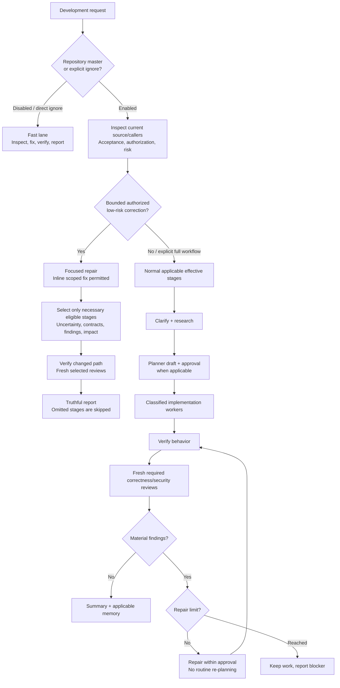
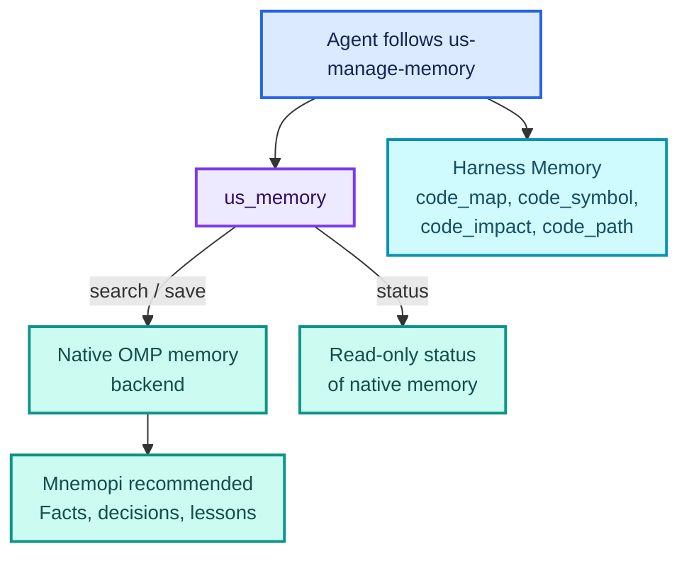

<p align="center">
  <picture>
    <source media="(prefers-color-scheme: dark)" srcset="docs/brand/lockup-dark.svg">
    
  </picture>
</p>

# Harness Skills for Oh My Pi, Claude Code, OpenCode, Codex, and Pi

**From a natural-language request to reviewed, verified work.**

Owned `us-*` skills for development, focused audits, delivery, and project memory. Oh My Pi (OMP), Claude Code, OpenCode, Codex, and Pi discover their descriptions; the model follows the relevant instructions using native tools and workers.

https://github.com/user-attachments/assets/86bc6cf3-b61e-4ade-9ebd-5e48b27fac38

<sub>A 72-second tour with sound: one request from research and plan approval through workers and fresh reviews to a verified pull request, then the short path for small fixes, read-only audits, memory and installation. The terminals are illustrations. [Download the full-quality 4K video](https://raw.githubusercontent.com/MSpiechowicz/harness-useful-skills/main/docs/video/harness-skills-tour.mp4) (27 MB).</sub>

| Develop | Inspect | Deliver | Remember |
| --- | --- | --- | --- |
| Clarify, research, approve, implement, review | Focused security, performance, and quality audits | Explicitly authorized feature-branch PR delivery | Durable facts alongside code relationships |

**Start here:** [Installation](#installation) · [Claude Code](#claude-code) · [OpenCode](#opencode) · [Codex](#codex) · [Pi](#pi) · [Workflow & skills](#skill-led-development) · [Model configuration](#native-model-configuration) · [Memory](#agent-invoked-memory)

**Reference:** [Management](#management) · [Audits & delivery](#focused-audits-and-delivery) · [Updates](#updates-and-releases) · [Development](#development-and-verification) · [Attribution](#attribution)

No Anvil dependency, custom workflow executor, model router, phase database, or stop-hook continuation loop.

## Installation

The OMP installation below requires OMP with marketplace support and Node.js **22+**. It needs no npm dependencies, build step, host configuration, prompt file, or startup flag. [Claude Code](#claude-code), [OpenCode](#opencode), and [Codex](#codex) have their own installation sections; the OpenCode installer edits OpenCode's `opencode.json` (see below), and the Codex installer registers an MCP server through the `codex` CLI.

```bash
omp plugin marketplace add MSpiechowicz/harness-useful-skills
omp plugin install harness-useful-skills@harness-useful-skills --scope user
```

These commands and `./useful-skills install` below require a published release of the new catalog; until then, load this source checkout with `omp -e /absolute/path/to/harness-useful-skills` as shown below.

Restart OMP after installation or update. Ordinary startup adds discovery and, when enabled for the current repository in the active profile, narrowly scoped session-local workflow-stage guidance. Use `--scope project` from the project directory for a project installation, or prefix both commands with `omp --profile NAME` for an isolated profile. Installation scope is separate from the repository-local workflow master and seven profile-wide stage preferences. The marketplace and plugin are both named `harness-useful-skills`; the OMP plugin ID is `harness-useful-skills@harness-useful-skills`. OMP does not import this plugin's Claude Code MCP server: its manifest declares empty `mcpServers`. Claude Code loads its own separate MCP tools when installed there.

### Upgrading from 0.3.x: one name everywhere

Releases after 0.3.13 (a breaking change) give every host the same name, `harness-useful-skills`. Install it as described below on top of an older install. The old names stop working, so update anything that mentions them (permission rules, prompts, scripts):

| What | Before | Now |
| --- | --- | --- |
| Claude marketplace and plugin ID | `useful-skills@useful-skills-local` | `harness-useful-skills@harness-useful-skills` |
| Codex plugin ID | `useful-skills@harness-useful-skills` | `harness-useful-skills@harness-useful-skills` |
| MCP server (Claude, OpenCode, Codex) | `useful_skills` | `harness-useful-skills` |
| Claude tools | `mcp__plugin_useful-skills_useful_skills__*` | `mcp__plugin_harness-useful-skills_harness-useful-skills__*` |
| OpenCode tools | `useful_skills_memory_status` and so on | `harness-useful-skills_memory_status` and so on |
| Claude skills and agents | `/useful-skills:us-*`, `useful-skills:planner` | `/harness-useful-skills:us-*`, `harness-useful-skills:planner` |
| Claude data and settings | `~/.claude/useful-skills/` | `~/.claude/harness-useful-skills/` |
| Generated Claude agents | `~/.claude/agents/useful-skills-*.md` | `~/.claude/agents/harness-useful-skills-*.md` |
| OpenCode | `plugins/useful-skills.js`, `plugins/useful-skills/`, `useful-skills/models.yml` | `plugins/harness-useful-skills.js`, `plugins/harness-useful-skills/`, `harness-useful-skills/models.yml` |
| Codex | `$CODEX_HOME/useful-skills/` | `$CODEX_HOME/harness-useful-skills/` |

The role agents `us-*`, the skill names `us-*`, the `/useful-skills` command, and the `./useful-skills` script keep their names. The old files are cleaned up only when they are safe to remove:

- **OpenCode and Codex:** re-run the installer (`install.sh`, `install.ps1`, or `./useful-skills install --host ...`). It removes the old plugin files, the `useful_skills` MCP entry and (Codex) the old plugin only while they are still what the old install wrote, keeps any file you edited and says so, and moves the data folders to the new names. Nothing is lost: a file is deleted from the old place only after an identical copy exists in the new one, and a `models.yml` you edited in both places stays in both. `uninstall` removes both the old and the new names. `doctor --host ...` reports whatever is left of an old install. The in-app `update install` of an old OpenCode runtime cannot install this release (the release no longer ships the old file names): run the install script once instead.
- **Claude Code:** install the new plugin (`claude plugin install harness-useful-skills@harness-useful-skills`) and remove the old one (`claude plugin uninstall useful-skills@useful-skills-local`), because Claude keeps them as two separate plugins and both would load. On its first session the new plugin moves `~/.claude/useful-skills/` (role models, saved settings) to `~/.claude/harness-useful-skills/`, replaces the generated agents `~/.claude/agents/useful-skills-*.md` with `harness-useful-skills-*.md` (only files Harness Skills generated), and copies the saved memory out of the old plugin's data folder. `/useful-skills doctor` lists a still-installed old plugin.
- **OMP:** the plugin ID did not change. The first session moves `<agentDir>/useful-skills/` (workflow settings, saved memory) to `<agentDir>/harness-useful-skills/`.

The environment of the retired Graphify integration (`dependencies/`) is not moved, because it holds absolute paths and nothing uses it any more.

### Remove or migrate an OMP installation

Uninstall each historic ID that is installed in the relevant scope; check `omp plugin list --json` if unsure. These commands remove installed plugins, not their marketplace registration:

```bash
omp plugin uninstall oh-my-pi-useful-skills@omp-useful-skills --scope user
omp plugin uninstall useful-skills@omp-useful-skills --scope user
```

An old installation is not renamed by updating a checkout or publishing a release, and loading the checkout does not remove its startup message. You can uninstall it before the new catalog is published. If no plugins need the old marketplace, optionally remove its registration with `omp plugin marketplace remove omp-useful-skills`. After the new catalog is published, use the installation commands above to add the new marketplace and install the new ID. The updater does not migrate old installations or marketplace registrations.

Uninstalling the plugin leaves the agents copied into `<agentDir>/agents`. They stay active in every project after the plugin is removed or disabled, so run `./useful-skills uninstall --host omp` first (add `--profile NAME` for a named profile): it deletes only the files this sync generated there (`~/.omp/profiles/NAME/agent` for a named profile, else `PI_CODING_AGENT_DIR`, default `~/.omp/agent`) and prints the `omp plugin uninstall harness-useful-skills@harness-useful-skills` command to run next.

For a project installation, run these commands from that project directory with `--scope project` instead of `--scope user`. For an isolated profile, prefix **each** command with `omp --profile NAME` instead of `omp`, retaining the original scope and project directory. Restart OMP after installation.

For local development, load the **package directory**, not the extension file alone:

```bash
omp -e /absolute/path/to/harness-useful-skills
```

`./useful-skills install [--scope user|project] [--profile NAME]` installs the published marketplace plugin, not the checkout itself. Source checkouts are updated with `git pull --ff-only`; the updater never overwrites them.

### Claude Code

The Claude Code adapter requires Node.js **22+** and a marketplace installation. For a local checkout, use its absolute path:

```bash
claude plugin marketplace add /absolute/path/to/harness-useful-skills --scope user
claude plugin install harness-useful-skills@harness-useful-skills --scope user
```

Or add the same repository as a GitHub marketplace:

```bash
claude plugin marketplace add MSpiechowicz/harness-useful-skills
claude plugin install harness-useful-skills@harness-useful-skills --scope user
```

The Claude plugin ID is `harness-useful-skills@harness-useful-skills` in either case. Install through the marketplace, **not** `claude --plugin-dir .`: that loads the repository-root OMP `skills/` instead of the marketplace's selected Claude skills. Restart Claude Code after installation. The OMP installation, commands, and profile behavior above remain unchanged.

Claude exposes 22 namespaced skills (for example, `/harness-useful-skills:us-run-workflow`) and eight native agents: `planner`, `scout`, `frontend`, `backend`, `general-purpose`, `reviewer`, `security-reviewer`, and `release-assessor`. All declare `model: inherit`; per-role models come from a Claude-owned config file instead (see [Claude Code model roles](#claude-code-model-roles)). Permissions and stronger host rules remain authoritative. Plugin `userConfig` has eight default-`true` booleans: `workflow`, `research`, `plan`, `review`, `security_review`, `release_assessment`, `backend_memory`, and `code_graph` (the older `graphify_memory` is deprecated and read only while `code_graph` is unset). Configure them in Claude Code's `/plugin` configure flow or at install time with repeatable `--config key=false` flags (for example, `--config workflow=false`). Disabling `workflow` suppresses automatic stages without changing the other saved values. A **direct** `/harness-useful-skills:us-ignore-workflow` invocation bypasses package-mandatory stages for one request only; quoted or copied text is not an opt-out. With a recent Claude Code that supports mods, `/useful-skills` is also available: without arguments it opens a menu (**Settings**, **Status**, **Browse**, **Help**); with arguments it runs the commands in [Management](#management). Saved settings mirror OMP's layout under the Claude config directory (`$CLAUDE_CONFIG_DIR` or `~/.claude`): the per-repository workflow master is `useful-skills/workflow-settings/repositories/<sha256(scopeRoot)>/workflow.json` (same repository scope rules as OMP) and the seven profile-wide stage switches are `useful-skills/workflow-settings/<stage>.json`, all private. For each setting a saved file wins, then the `/plugin` option, then enabled; an unreadable or unsafe saved file makes that setting unknown with no fallback. `/plugin` options remain fallbacks, and the only control on Claude Code versions without mods.

The Claude plugin adds a **separate** local stdio MCP server with three tools: `memory_status`, `memory_search`, and `memory_save`. Facts are project-scoped private files under Claude plugin data, searched by literal text; they are **not** OMP's native Mnemopi facts and are not shared with them. The code graph comes from Harness Memory's separate `code_map`, `code_symbol`, `code_impact`, and `code_path` tools, not from this server. Do not save credentials, personal data, transcripts, or tool dumps; secret detection is only a backstop. A Bash pre-tool guard denies recognized dangerous commands, and successful tool responses can be redacted by `PostToolUse`; failed third-party tool responses (`PostToolUseFailure`) cannot receive equivalent redaction. These protections are not a sandbox or a substitute for Claude's permissions, user approval, or publication controls.

In Claude Code, `/useful-skills doctor` also prepares memory for the session's project (see [Management](#management)); it never writes the workflow or stage settings files.

To submit Claude Code to the Claude plugin directory, `node scripts/build-claude-plugin.js` generates a Claude-only plugin bundle at `plugins/claude/`; the self-hosted marketplace install above is unchanged. `plugins/claude/` is generated: run the script after editing Claude runtime files or skills (CI runs it with `--check`). Only `plugins/claude/README.md` and `plugins/claude/evals/` (cases for `claude plugin eval`) are hand-written, and generated output is outside the 500-line cap.

OMP's updater and release process do **not** update the Claude or OpenCode installations automatically (OpenCode has its own `update` commands, and Codex updates by re-running its installer).

### OpenCode

The OpenCode adapter supports OpenCode v1.x (plugin API V1, tested on 1.19.3) and OpenCode v2.x (plugin API V2, tested on 2.1.2) and needs Node.js **22+** on `PATH`: the plugin itself runs under OpenCode's own runtime, but settings, memory, and doctor run as Node subprocesses. One installed `plugins/harness-useful-skills.js` serves both: its default export carries the V1 `server` function and the V2 `setup` function, and each OpenCode reads the one it knows ([OpenCode V2](#opencode-v2)).

One-line install of the latest release into your user config (macOS and Linux, needs `curl`, `tar`, `gzip`, and Node.js 22+):

```bash
curl --proto '=https' --tlsv1.2 -fsSL https://raw.githubusercontent.com/MSpiechowicz/harness-useful-skills/main/install.sh | sh
```

On Windows (PowerShell, needs the `tar.exe` in System32 from Windows 10 or newer, and Node.js 22+):

```powershell
irm https://raw.githubusercontent.com/MSpiechowicz/harness-useful-skills/main/install.ps1 | iex
```

The script downloads the release tarball from GitHub over HTTPS, runs the same checks as `update install` (no links, no absolute or `..` paths, one top-level directory, a `package.json` and plugin manifest that both match the release tag), and then runs that release's `./useful-skills install --host opencode --scope user` from your home directory. Nothing is installed when a check fails, and the temporary download is always removed. Set `HARNESS_SKILLS_VERSION` to a release tag such as `v0.3.7` to install that release instead of the latest (also the way around a failed GitHub API lookup). Put the variable on the shell that reads the script, not on `curl`:

```bash
curl --proto '=https' --tlsv1.2 -fsSL https://raw.githubusercontent.com/MSpiechowicz/harness-useful-skills/main/install.sh | HARNESS_SKILLS_VERSION=v0.3.7 sh
```

```powershell
$env:HARNESS_SKILLS_VERSION = 'v0.3.7'; irm https://raw.githubusercontent.com/MSpiechowicz/harness-useful-skills/main/install.ps1 | iex
```

Re-run the installer to update. The PowerShell script cannot stop a download at the size cap (it checks `Content-Length` when sent and the file afterwards), and it does not check extracted hard links.

Or install from a checkout, which also supports the `project` scope:

```bash
./useful-skills install --host opencode [--scope user|project]
```

Restart OpenCode afterwards. The default scope is `user`. Omitting `--host`, or `--host omp`, keeps today's OMP behavior; `--profile` with `--host opencode` is an error.

What it writes, all under the scope directory (`<config>/opencode` for `user`, where `<config>` is `$XDG_CONFIG_HOME` if absolute, else `~/.config`; `<cwd>/.opencode` for `project`):

- `plugins/harness-useful-skills.js`, `plugins/harness-useful-skills/**`, and `plugins/harness-useful-skills/install-record.json` (version, scope, paths, and a SHA-256 for every owned file)
- `skills/us-*` (22 skills), `commands/useful-skills.md`, and `commands/us-ignore-workflow.md`
- `agents/us-<agent>.md`, generated from the bundled templates with a `# Generated by Useful Skills` marker (see [OpenCode model roles](#opencode-model-roles))
- `harness-useful-skills/models.yml` in the scope directory
- an `mcp.harness-useful-skills` entry in `opencode.json` (below)

Outside the scope directory, the plugin keeps data at `${XDG_DATA_HOME:-~/.local/share}/opencode/harness-useful-skills` (mode `0700`) and workflow settings at `${XDG_CONFIG_HOME:-~/.config}/opencode/harness-useful-skills/workflow-settings/` for **both** scopes, in the same layout as OMP and Claude Code. `OPENCODE_CONFIG_DIR` is not an install target.

**Config edit.** The installer adds or updates only `mcp.harness-useful-skills` (a local server running `node` on the installed `mcp-server.js`, `enabled`, `timeout` 600000) in the scope's `opencode.json`, or in a comment-free `opencode.jsonc` when that is the file present. It never clobbers other keys and reports a different existing `mcp.harness-useful-skills` before replacing it. It refuses to edit a config that contains comments, does not parse, is not an object, has a non-object `mcp`, or is a symlink: it then prints the snippet to add yourself and exits 0 with "Action required".

**Ownership.** The installer never overwrites a file it does not own or one you edited since installing, and refuses symlinked targets. Project scope writes `<cwd>/.opencode/` and its `opencode.json` with machine-specific absolute paths; add them to `.gitignore` instead of committing them.

**Update.** `./useful-skills update check|install --host opencode` (or `/useful-skills update check|install` in chat) downloads the latest stable GitHub release tarball over HTTPS, verifies it (no links, no absolute or `..` paths, matching versions) and runs its installer for the recorded scope. Nothing changes on any failure. It updates the installed copy, never the checkout, and works from the first release that contains the OpenCode adapter. On OpenCode 1.x the plugin also makes one quiet check at startup and shows a toast when a newer release exists.

**Uninstall.** `./useful-skills uninstall --host opencode [--scope user|project]` removes only owned files that still match their recorded hash, marker-owned agents, and the `mcp.harness-useful-skills` entry if it is unchanged. It keeps data, settings, and `models.yml`, and prints their paths. `./useful-skills doctor --host opencode` reports the installation from the terminal.

OpenCode exposes the 22 skills by their plain `us-*` names through its `skill` tool and as `/us-*` slash commands. Workers are the eight `us-*` agents below, dispatched with the `task` tool. The memory MCP server adds `harness-useful-skills_memory_status`, `harness-useful-skills_memory_search`, and `harness-useful-skills_memory_save`: project-scoped private facts under the OpenCode data directory searched by literal text. They are not shared with OMP or Claude Code facts. A Bash pre-tool guard that denies recognized dangerous commands is always on, as in Claude Code, and successful tool output is redacted for common secret patterns.

Limits:

- OpenCode skips the after-tool hook when a tool fails, so failed tool output is **not** redacted.
- `/useful-skills` output is relayed by the model: the plugin runs the command and the model is told to show the result verbatim, best-effort.
- On OpenCode 1.x, workflow guidance uses `experimental.chat.system.transform`, which OpenCode may change.
- Like the other hosts, the Bash guard does not stop a model from running the bundled `command.js` or editing settings files through tools; the restriction that settings change only from commands you type applies to the plugin's command path, not to everything a model can do.
- On OpenCode 1.x, workflow context is added to every LLM call in a session, including OpenCode's title and compaction calls: plugin API V1 cannot tell them apart from chat turns. OpenCode 2.x has separate hooks, so only the agent's own requests get it.
- Startup runs `sync-agents` (it writes `harness-useful-skills/models.yml` and the generated agents) and one read-only update check, which may call `gh auth token` to raise the GitHub rate limit; both fail quietly.
- The installer re-serializes `opencode.json` as 2-space JSON, so exotic numeric values and duplicate keys normalize.
- Long `/useful-skills` commands (`doctor`, `update install`) have a 10-minute budget (60 seconds for the others), and their subprocesses are stopped when OpenCode quits.
- These protections are not a sandbox or a substitute for OpenCode's permissions.

#### OpenCode V2

OpenCode 2.x loads `plugins/harness-useful-skills.js` as a plugin definition (`export default { id, setup }`) and rejects a file with only named exports. OpenCode 1.x reads the same default export and calls its `server` function, so the installed entry exports one object with `id`, `server` (V1), and `setup` (V2), and the installer is the same for both. The runtime directory `plugins/harness-useful-skills/` is ignored by the V2 loader because it has no `index` or `server` module.

`opencode/v2.js` maps the V2 Promise plugin API onto the same session logic as V1, with these differences:

| Behavior | OpenCode 1.x | OpenCode 2.x |
|---|---|---|
| Workflow guidance | `experimental.chat.system.transform` | `session.hook("context")`, appended to the system prompt of the agent's requests only (not title or compaction) |
| Per-prompt refresh | `chat.message` | `session.hook("prompt")` |
| Bash guard and redaction | `bash` tool, `tool.execute.before/after` | `shell` (or `bash`) tool, `tool.hook("execute.before"\|"execute.after")`, plus redaction of background and user shell output messages in `session.hook("context")` |
| Subagent sessions | `session.created` event, then a session lookup | `ctx.event.subscribe` events, then a session lookup |
| `/useful-skills`, `/us-ignore-workflow` | `command.execute.before` | plugin commands registered with `ctx.command.transform` (see below) |
| Update and Node.js notices | toasts | none: V2 server plugins have no toast, and the startup update check is skipped |

OpenCode 2.x has no command hook. The plugin registers `useful-skills` and `us-ignore-workflow` as plugin commands, so they run only when you (or a client acting for you) run the command, never because some prompt text looks like one: the `prompt` hook also sees MCP prompt commands, API clients, and other plugins. A command runs only in a session the host confirms is a main session, and the commands in `commands/*.md` stay as the fallback that tells the model nothing ran. The host applies command registrations in order and its own markdown-command loader registers after plugins, so the plugin checks the host's command list and registers again whenever its commands are no longer the active ones, giving up after five registrations in a row that the list does not confirm. A command typed within milliseconds of a project loading can still reach the fallback text. `/useful-skills` sends its relayed result as the prompt, and `/us-ignore-workflow` sends the text of its markdown file with what you typed and opts that one request out. The plugin reads the `us-ignore-workflow` file when it loads, so edits to it apply after a restart. V2 limits: a failed tool's error text is not redacted (V1 never sees failed tools at all), background shell output is redacted in what the model receives but the host stores and shows the original, and long commands show no progress notice.

### Codex

The Codex adapter needs Node.js **22+** and the `codex` CLI. Installing only the plugin gives you the 22 skills, as `harness-useful-skills:us-*`, but no agents and no memory tools:

```bash
codex plugin marketplace add MSpiechowicz/harness-useful-skills
codex plugin add harness-useful-skills@harness-useful-skills
```

The marketplace and the plugin are both called `harness-useful-skills`, so the plugin ID is `harness-useful-skills@harness-useful-skills`. The repository has a Codex catalog at `.agents/plugins/marketplace.json`, so Codex reads it instead of falling back to `.claude-plugin/marketplace.json`; Claude Code and OMP are unaffected.

For the full install (macOS and Linux, needs `curl`, `tar`, `gzip`, Node.js 22+, and `codex`):

```bash
curl --proto '=https' --tlsv1.2 -fsSL https://raw.githubusercontent.com/MSpiechowicz/harness-useful-skills/main/install.sh | HARNESS_SKILLS_HOST=codex sh
```

On Windows (PowerShell):

```powershell
$env:HARNESS_SKILLS_HOST = 'codex'; irm https://raw.githubusercontent.com/MSpiechowicz/harness-useful-skills/main/install.ps1 | iex
```

Or, from a checkout or an extracted release:

```bash
./useful-skills install --host codex [--local]
```

The install script verifies the release tarball as described for [OpenCode](#opencode), then runs that release's installer. `HARNESS_SKILLS_VERSION` pins a release here too. Releases up to v0.3.12 have no Codex adapter, and the script refuses them before running anything. The installer:

- adds the marketplace (from GitHub at `--ref v<version>`, or from the checkout with `--local`) and the `useful-skills` plugin. Without `--local`, it first checks with `git ls-remote` that the release tag exists and stops before writing anything if it does not (use `--local` for an unreleased checkout); without `git` or a network it notes that and continues;
- writes eight agents to `$CODEX_HOME/agents/us-<role>.toml`: `us-planner`, `us-scout`, `us-frontend`, `us-backend`, `us-general-purpose`, `us-reviewer`, `us-security-reviewer`, and `us-release-assessor`;
- copies the memory runtime to `$CODEX_HOME/harness-useful-skills/runtime/` and creates the private data directory `$CODEX_HOME/harness-useful-skills/data`;
- registers the MCP server `harness-useful-skills` with `codex mcp add`, exposing `memory_status`, `memory_search`, and `memory_save`;
- creates `$CODEX_HOME/harness-useful-skills/models.yml` when it is missing and writes its roles into the agents (see [Codex model roles](#codex-model-roles));
- writes `$CODEX_HOME/harness-useful-skills/install-record.json`.

Restart Codex afterwards. The installer never edits `config.toml`. The memory server is registered by the installer, not shipped in the plugin, because Codex does not expand `${PLUGIN_ROOT}` in a plugin's `.mcp.json` and gives plugin servers no workspace. Memory has the same contract as in Claude Code and OpenCode (see [Agent-invoked memory](#agent-invoked-memory)); a slow memory operation may need `tool_timeout_sec` under `[mcp_servers.harness-useful-skills]` in your `config.toml`, which you set yourself.

**Uninstall, doctor, update.** `./useful-skills uninstall --host codex` removes only unmodified owned files, the MCP entry if unchanged, the plugin if the installer added it, and the marketplace if the installer added it. It keeps the data directory and `models.yml`. `./useful-skills doctor --host codex` prints a read-only health summary, including a plugin left at an older version by an interrupted upgrade. To update, re-run the installer. On Windows the installer runs `codex.exe` directly; an npm `codex.cmd` shim runs through `cmd.exe`, and the installer refuses when a path it passes contains `"`, `%`, `!`, `^`, `&`, `|`, `<` or `>`.

Limits:

- Workflow stages are static guidance and always enabled. Codex has no settings command or `/useful-skills` command. The one hook is the code-graph hint: the installer registers a `PreToolUse` entry for `Bash` in `$CODEX_HOME/hooks.json` (never `config.toml`), which nudges toward the code tools when a shell command greps an identifier. Codex skips a new hook until you review and trust it in `/hooks`. Uninstall removes only that entry. To skip the workflow for one request, invoke `$us-ignore-workflow` directly.
- Read-only agents (such as `us-scout` and the reviewers) are read-only by instruction only: Codex subagents inherit the parent's sandbox, so the sandbox, not the agent file, is the enforcement.
- Models are per agent only through `models.yml`; a role set to `inherit` (the default) uses Codex's own model and reasoning effort.
- Plugin-only installs have no `us-*` agents, so `us-run-workflow` reports the missing agent types.

### Pi

Install the skills as a Pi package. It needs only the `pi` CLI:

```bash
pi install git:github.com/MSpiechowicz/harness-useful-skills
```

Pi loads only the skills listed in the `pi` key of `package.json`, which points at the generated `pi/skills/` copy of the 22 skills, not the OMP-flavoured `skills/` folder. Regenerate it with `node scripts/render-pi-skills.js`. Behaviour on Pi:

- Workflow stages are static guidance and always enabled. Pi has no Useful Skills settings command or `/useful-skills` command. To skip the workflow for one request, invoke `/skill:us-ignore-workflow` directly.
- Pi has no worker tool, so planner, scout, and implementation work run inline in the main session and are reported as "ran inline (Pi has no worker tool)". Plan approval is still required before edits.
- Correctness review, security review, and release assessment run as a fresh read-only child `pi` process with only the `read`, `grep`, `find`, and `ls` tools, no extensions, skills, or context files, and the brief and diff attached. The role prompts are in `pi/agents/`. The child cannot run commands, so a security reviewer describes any reproduction and the main session runs it. A child that fails or prints nothing is reported as a stage that could not be met.
- The child is started by `pi/bin/run-child.sh <role> <base-ref> <brief-file> [--ui]` (POSIX `sh`). It attaches the role, the diff (untracked files by name only), and the brief, runs with `--offline --no-extensions --no-mcp --no-skills --no-approve` and no `--model`, and deletes its temporary files. `PI_CHILD_TIMEOUT` (seconds, default 1800) sets the time limit, enforced only where the `timeout` command exists (not on stock macOS). Pass the pull request base for committed branch work and `HEAD` only for uncommitted-only work.
- Pi loads no Useful Skills extension, so there is no catastrophic-command guard or output redaction. Pi's own permissions apply.
- The tool allowlist enforces the read-only limit (no bash, edit, or write). Staying inside the repository is a prompt rule only, because the read tools can reach any path. Check the child's output for secrets before reusing it.
- Models are never configured here. The child process uses your own Pi default model, which may come from a different provider than the main session.
- Memory comes from the Harness Memory MCP tools (`note_*`, `code_*`) when Pi lists them. There is no Useful Skills memory tool on Pi.

## Skill-led development

Ask naturally: “I want to build a rocket simulator.” Before composing stages, `us-run-workflow` inspects current source, relevant callers, acceptance, authorization, and risk, then briefly explains the selected lane. With the repository master enabled, the default full stages apply to normal work; a clear bounded low-risk correction within an authorized outcome can instead use focused repair. Size, urgency, a stale plan, or “already delivered” alone does not qualify.



Focused repair requires current source/caller inspection, an authorized scoped fix, observable changed-path verification, and a truthful report. A current bounded repair request or prior in-scope approval can authorize it without routine new planning/approval. The parent may fix inline; enabled switches alone do not require a new scout, planner, implementation worker, full reviews, or memory cycle. Select extra eligible stages for actual uncertainty, affected contracts, findings, or security/memory impact; follow each selected stage's own rules without automatically restarting the full flow. Disabled/unknown automatic stages are never silently activated, and explicit audits/full-workflow requests and independent controls remain binding.

Use normal composition for new or material behavior, architecture, broad/ambiguous failures, uncertain scope, security-sensitive changes, or an explicit full-workflow request. Investigate ambiguity before calling a failure small. In an already active normal workflow, repairs retain its required workers and fresh reviews; do not retroactively switch lanes to omit them. Prior approval covers in-scope repair without a new planner/approval cycle. Verification failures return to implementation; every required or selected review must be fresh after affected changes, and prior reviews do not cover newly changed code. Three unsuccessful repair rounds or repeated no progress stop the loop. Skipped stages are never called complete; an applicable required memory failure prevents claiming full completion. Publication is separate and explicitly authorized.

The parent owns objective, lane selection, research scope, native todo, acceptance, applicable approval, integration, and combined verification. In normal composition, enabled research uses a read-only worker and enabled planning uses native `planner` after parent inspection, followed by one approval. With no applicable plan stage, a bounded request can authorize implementation, subject to independent requirements. Required implementation packages—including one package—use `frontend`, `backend`, or native `task` for genuinely neither (documentation/tooling); eligible focused repair may be inline. Split coherent mixed boundaries, serialize dependencies/shared files, and parallelize only ready disjoint packages. Selected focused stages retain their own dispatch rules. Current source, not historical plans/transcripts alone, governs interrupted work.

Ordinary installed startup supplies discovery and a narrow session-local stage policy while the effective repository workflow is enabled. Each prompt reconciles owned instructions using the active workspace's master and profile stage preferences, preserving unrelated guidance. Enabled settings mean stage eligibility, not automatic execution; triage permits focused inline repair. A required applicable plan permits bounded `planner` dispatch after inspection; required classified implementation dispatch follows appropriate authorization, including a single package. No global repository is selected and no general extra delegation is authorized. Disabled master supplies fast-lane guidance. Native `/skill:us-ignore-workflow` selects a one-request exception separately: the extension does not classify prompt text or persist that choice. Startup never dispatches workers, builds anything, writes workflow state, or starts a model workflow.

These are prompt instructions, **not enforced stage transitions**. They cannot guarantee model compliance or override stronger safety constraints, existing mappings, permissions, independent approval boundaries, or publication rules. Ordinary explanations and explicitly focused audits do not start the full development workflow. Plan approval does not authorize publication.

For a persistent development fast lane, run `/useful-skills workflow disabled` **from the intended repository**; `/useful-skills workflow enabled` restores that repository's master in the active OMP profile. The choice survives sessions/restarts without affecting other repositories. The nearest canonical Git checkout root is the scope: root, subdirectories, and symlink aliases share; separate checkouts and linked worktrees isolate, as do nested checkouts. Outside Git, canonical cwd is the scope, so distinct non-Git directories are separate. Moving a checkout changes its path-derived identity; no relocation migration is performed.

The master is stored privately at `<agentDir>/harness-useful-skills/workflow-settings/repositories/<sha256(scopeRoot)>/workflow.json`; seven stage files remain in `<agentDir>/harness-useful-skills/workflow-settings/`. Reads create nothing. Storage retains private directories/files, bounded no-follow reads, and atomic writes. Identity discovery inspects filesystem Git markers without executing project code or hooks. Unreadable/unsafe identity makes only the master unknown while independently readable profile stages remain visible; unknown automatic stages do not run. Status exposes canonical scope, master file, profile stage directory, saved/effective selections, and scoped errors.

**Legacy master:** the old profile-level `<agentDir>/harness-useful-skills/workflow-settings/workflow.json` is untouched and ignored, with no fallback, copying, or automatic migration. A missing new repository master defaults enabled. To retain an old disabled choice, enter the intended repository and reapply `/useful-skills workflow disabled`.

Alternatively, directly invoke native `/skill:us-ignore-workflow` for one request without changing saved settings. Quoted/copied invocations are not selection. The disabled-master/direct-ignore fast lane still inspects current code/callers, implements and exercises the changed path, and reports evidence, but skips package-mandatory stages. It is distinct from enabled focused repair and does not waive stronger safety/permissions, independent authorization, explicit audits, or publication controls.

Seven retained **profile-wide** switches control eligibility for individual automatic stages across repositories; all default enabled and changing one leaves the others intact. In normal composition, apply effective stages. Focused repair selects only necessary eligible extras rather than inheriting the whole cycle. Use `/useful-skills stage <name> enabled|disabled` with a name from this table:

| Stage name | When disabled |
| --- | --- |
| `research` | Skip the package-mandatory research stage; still inspect essential source code, callers, and behavior needed for the request. |
| `plan` | Skip the package-mandatory planner draft and plan approval; independently required authorization still applies. |
| `review` | Skip the automatic correctness review; security review remains independently controlled. |
| `security-review` | Skip the automatic security review; correctness review remains independently controlled. |
| `release-assessment` | Skip the automatic release assessment (review tier, release confidence, and the Review guide); an explicit assessment request still runs. |
| `backend-memory` | Skip automatic native-memory fact search/save guidance, not explicit memory actions or host retention. |
| `code-graph` | Skip automatic code graph guidance (`code_map`, `code_symbol`, `code_impact`, `code_path`), not explicit requests. The earlier name `graphify-memory` is still read and accepted. |

Disabling a repository master suppresses all automatic stages there without changing the seven profile-wide saved preferences or any other repository's master. Re-enabling restores their eligibility, not proof of execution; a disabled stage remains disabled. Direct one-request ignore takes precedence for that request only. Memory opt-outs are guidance, not provider/tool bans: explicit `us_memory`, graph test, doctor, and native `/memory` remain available and do not alter backend settings or host `autoRetain`. Configure host retention separately if unwanted. Prompt guidance cannot guarantee model compliance.

| Skill | Selection and responsibility |
| --- | --- |
| `us-run-workflow` | Natural development requests; pre-composition risk triage and applicable effective stages |
| `us-ignore-workflow` | Explicit one-request fast lane; changes no repository/profile settings |
| `us-grill-me` | Consequential unresolved product/engineering choices; inspect before asking |
| `us-research` | Current source/callers, conventions, documentation, and applicable memory when selected |
| `us-plan` | Applicable planner draft, concrete acceptance/ownership, one approval |
| `us-implement` | Authorized implementation/repairs, inline focused or required classified workers |
| `us-review` | Fresh required/selected evidence-based correctness review |
| `us-assess-release` | Fresh read-only release assessment after review and security review: tier T0–T6, confidence, and what a human should check, also as a PR "Review guide" |
| `us-manage-memory` | Explicit or applicable automatic recall and code graph lookups and verified fact updates |
| `us-write-concisely` | Caveman-lite context/prose guidance; preserves technical meaning and exact text |
| `us-delete-safely` | Before recursive deletes or cleanup: never the root, home, workspace or its parents, or another repository; untracked build/temp folders freely; ask for the rest |
| `us-mockup-views` | Big view/layout changes with several plausible designs: clickable HTML mockups opened in the browser so the user picks |
| `us-keep-ui-consistent` | Any change to how a UI element looks or behaves, or on request: the same change applied to every sibling instance across views, with a per-instance report and an optional extraction proposal |
| `us-use-harness-memory` | Only with the separate `harness-memory` MCP tools: search notes and saved scripts at task start, before repeating a shell command, and after compaction; save repeated deterministic actions as scripts and outcomes, fixes, and decisions as notes; never self-approve a script. Not `us-manage-memory` |
| `us-check-security` | Read-only trust-boundary audit or post-correctness security review |
| `us-check-performance` | Measured representative performance audit, not speculative optimization |
| `us-check-code-quality` | Evidence-backed cohesion/duplication audit and explicit guidance merge |
| `us-improve-codebase-architecture` | Read-only architectural opportunities, then approved focused refactoring |
| `us-improve-code-coverage` | Measured coverage gaps, then approved behavior-focused test improvements |
| `us-ship-backlog-item` | One item, isolated feature branch, reviewed linked PR, and Done only after confirmed merge |
| `us-open-pr` | Explicitly authorized reviewed feature-branch PR delivery |
| `us-approve-work` | Explicitly authorized approved-only commit and safe feature-branch PR against the verified GitHub default branch; commit-only stays local |

Direct invocation uses OMP's actual syntax:

```text
/skill:us-ignore-workflow
/skill:us-check-security
/skill:us-check-performance
/skill:us-check-code-quality
/skill:us-improve-codebase-architecture
/skill:us-improve-code-coverage
/skill:us-ship-backlog-item
/skill:us-open-pr
/skill:us-approve-work
```

No extension-command wrapper is installed for each skill. Add a matching `skills/us-example/SKILL.md` with a concrete single-line frontmatter `description`; native shallow discovery and the catalog need no JavaScript registry update. Keep substantial checklists/worker briefs in skill-local references linked through `skill://us-<name>`.

### Jev assessment — no integration

Assessed 2026-09-23: [TypeSafe's coding-agent guidance](https://docs.typesafe.ai/introduction/coding-agents) positions Jev for narrow typed decisions inside an application, not as a drop-in coding agent. It could advise on bounded classifications, but is not a workflow executor or an authority for agent dispatch or approval.

The [official API](https://docs.typesafe.ai/api) documents `POST https://api.typesafe.ai/v1/systemone` with state and typed questions; [Jev 1.13 model limits](https://docs.typesafe.ai/models) are 64k tokens total per request and 32k tokens for the state plus longest question. The [community Jev API page](https://www.jevai.org/docs) separately claims a `https://www.jevai.org/api/v1/decisions/route` endpoint and a 32 KiB HTTP body cap; neither is corroborated by the official TypeSafe docs.

Sending task context would disclose prompt data to the service. TypeSafe's [privacy policy](https://typesafe.ai/legal/privacy-policy) says inputs are not used to train or fine-tune models but gives no fixed API-log retention period. Its [Master Customer Agreement](https://typesafe.ai/legal/mca) permits Customer Data processing during the term and in perpetuity for telemetry, fraud prevention, and legal purposes; telemetry may be processed without restriction, including to improve services and products. API calls consume credits under that agreement.

No Jev integration is included and no task context is sent. Any future integration requires separate explicit approval and opt-in context transmission; its output must remain advisory and cannot replace parent judgment or human approval.

## Native model configuration

Harness Skills bundles native `planner`, `frontend`, `backend`, and `release-assessor` agents; it does not add a model router or workflow executor. OMP's task tool reads agents only from `<agentDir>/agents` (default `~/.omp/agent/agents`), not from a plugin, so each OMP session start copies them there as `planner.md`, `frontend.md`, `backend.md`, and `release-assessor.md`, each marked with a `# Generated by Useful Skills` comment. A file with one of those names that Harness Skills did not generate is never overwritten, and `/useful-skills doctor` reports it as a conflict. The copies are user-wide even for a project-scope install. OMP reads the agents when it starts, so the first session after installing or updating may not offer them yet. Ordinary startup needs no role mapping, global host override, prompt file, or extra flag for its narrow session-local policy. The repository master and profile stage preferences determine eligibility; pre-composition triage determines applicability. Existing OMP mappings remain authoritative. Optional distinct mappings use native roles in the active profile, project configuration, overlays, or runtime options; Harness Skills never changes them.

Open `/model`, then the **Roles** view, to optionally assign and persist role mappings. This example uses only OpenAI Codex selectors; availability depends on your OMP model catalog and credentials, not on this table.

| Role | Native task agent | Example model |
| --- | --- | --- |
| `research` | `scout` | `openai-codex/gpt-5.6-luna:xhigh` |
| `frontend` | `frontend` | `openai-codex/gpt-5.6-terra:high` |
| `backend` | `backend` | `openai-codex/gpt-5.6-terra:high` |
| `implementation` | `task` | `openai-codex/gpt-5.6-terra:high` |
| `review` | `reviewer` | `openai-codex/gpt-6-astra:medium` |
| `security` | `security-reviewer` | `openai-codex/gpt-5.6-sol:high` |
| `plan` | `planner` | `openai-codex/gpt-6-astra:high` |
| `assess` | `release-assessor` | Optional. Inherits the session model when absent |

`task` is reserved for work genuinely neither frontend nor backend.

`planner` and `release-assessor` are bundled and read-only. `release-assessor` declares no `model`, so it inherits the session model. To pick one, set `task.agentModelOverrides` for it, for example `release-assessor: "@assess"` with an `assess` entry in `modelRoles`.

```yaml
modelRoles:
  research: openai-codex/gpt-5.6-luna:xhigh
  frontend: openai-codex/gpt-5.6-terra:high
  backend: openai-codex/gpt-5.6-terra:high
  implementation: openai-codex/gpt-5.6-terra:high
  review: openai-codex/gpt-6-astra:medium
  security: openai-codex/gpt-5.6-sol:high
  plan: openai-codex/gpt-6-astra:high

task:
  agentModelOverrides:
    scout: "@research"
    frontend: "@frontend"
    backend: "@backend"
    task: "@implementation"
    reviewer: "@review"
    security-reviewer: "@security"
    planner: "@plan"
```

Native dispatch selects an **agent type**, not a model. For every dispatched agent, `task.agentModelOverrides[agentName]` always wins; otherwise OMP uses the agent's `model` frontmatter and then its native fallback. Role aliases such as `@review` resolve through `modelRoles`. `frontend` and `backend` prioritize `@frontend` and `@backend` respectively, then `@implementation`; `planner` declares `model: "@plan"`. These optional mappings and frontmatter do not prove the running worker's model. Do not edit user configuration automatically.

Loading a skill or defining a role does not execute that role's model. With workflow effectively enabled, pre-composition triage permits eligible focused inline repair without automatic planner, approval, or worker dispatch. Normal applicable enabled planning uses a bounded `planner` draft and one approval; normal implementation uses classified `frontend`, `backend`, or `task`, including one required package. Without an applicable plan stage, bounded authorization can suffice subject to independent requirements. Optional focused delegation retains classification and host permissions. Active normal-workflow repairs keep required workers and fresh reviews without routine new approval. Report configured routing separately from actual worker/model metadata.

After installation/restart the package advertises native agents and defaults to enabled repository masters and profile stage preferences unless saved otherwise. If a required agent is absent, routing cannot resolve, or stronger host policy prohibits dispatch, report the exact limitation rather than silently replacing it with parent work or claiming its model ran. Missing runtime metadata is not proof of a routing failure; report only observed metadata. Eligible focused inline repair remains allowed. A permitted fallback reports actual routing, not successful requested-role execution. See [Native model routing](skills/us-run-workflow/SKILL.md#native-model-routing); reading it does not launch the workflow.


### Claude Code model roles

Claude Code does not read OMP's `config.yml`. Its role models live in a Claude-owned file, `~/.claude/harness-useful-skills/models.yml` (under `$CLAUDE_CONFIG_DIR` when set). The plugin's `SessionStart` hook creates it with these defaults the first time Claude Code starts after installation:

```yaml
modelRoles:
  research: claude-haiku-5-5:high
  frontend: claude-sonnet-5-5:high
  backend: claude-opus-5-5:high
  implementation: claude-sonnet-5-5:high
  review: claude-sonnet-5-5:medium
  security: claude-opus-5-5:high
  plan: claude-opus-5-5:high
  default: claude-opus-5-5:medium
```

The optional `assess` role (for `release-assessor`) is not in the defaults. When absent it inherits the session model and never falls back to `default`. Add `assess: <selector>` to pin one.

A selector is `<model>[:<effort>]`: a Claude model ID or alias (`opus`, `sonnet`, `haiku`, `fable`, `inherit`) and an optional effort (`low`, `medium`, `high`, `xhigh`, `max`). An OMP-style `anthropic/` prefix is accepted, so the same values work in OMP and Claude Code. A missing role uses `default`. `default` does not change the main session model; choose that with Claude's `/model`.

Claude Code cannot apply plugin options to plugin agent frontmatter, and the `Agent` tool accepts only model aliases without effort. So on each session start the hook generates user-level agents `us-planner`, `us-scout`, `us-frontend`, `us-backend`, `us-general-purpose`, `us-reviewer`, `us-security-reviewer`, and `us-release-assessor` in `~/.claude/agents/harness-useful-skills-*.md`. Each one copies the bundled agent's instructions and tools and sets the configured `model` and `effort`. The hook tells the session to dispatch them in place of the `harness-useful-skills:*` agents. Role mapping matches OMP: `scout` ← `research`, `planner` ← `plan`, `general-purpose` ← `implementation`, `reviewer` ← `review`, `security-reviewer` ← `security`, `release-assessor` ← `assess`.

Claude Code loads agents at startup, so edits to `models.yml` take effect in the **next** session; the first session after installation still uses the inherited-model plugin agents. An invalid file is reported and leaves existing generated agents unchanged. A file at one of those paths that Harness Skills did not generate is never overwritten; that role falls back to its plugin agent. Uninstalling the plugin does not remove the generated files; delete `~/.claude/agents/harness-useful-skills-*.md` and `~/.claude/harness-useful-skills/` yourself.

### Codex model roles

Codex has no session hook, so its role models are written into the agent files when you ask. They live in `$CODEX_HOME/harness-useful-skills/models.yml` (`~/.codex/harness-useful-skills/models.yml` by default), which has the same schema as the Claude and OpenCode files. The installer creates it with comments and every role set to `inherit`, and never rewrites an existing one:

```yaml
modelRoles:
  default: inherit
  review: gpt-5.5:high
  security: gpt-5.5:xhigh
```

A selector is `<model>[:<effort>]`, `inherit`, or `inherit:<effort>` (change only the effort). The suffix is an effort only when it is one of `none`, `minimal`, `low`, `medium`, `high`, or `xhigh`; anything else stays part of the model. Roles are `research`, `frontend`, `backend`, `implementation`, `review`, `security`, `plan`, `assess`, and `default`, which applies to a role whose row is removed. `assess` is the exception: when absent it inherits the session model and never falls back to `default`. Roles map to agents as in the OMP table: `us-scout` ← `research`, `us-planner` ← `plan`, `us-general-purpose` ← `implementation`, `us-reviewer` ← `review`, `us-security-reviewer` ← `security`, `us-release-assessor` ← `assess`.

The installer writes `model` and `model_reasoning_effort` into `$CODEX_HOME/agents/us-<role>.toml` (a role that inherits gets neither line). After editing `models.yml`, apply it without reinstalling:

```bash
./useful-skills models apply --host codex
node "$CODEX_HOME/harness-useful-skills/runtime/codex/apply-models.js" [--json]
```

The second form runs from the installed runtime, needs no checkout and no `codex` command. An invalid file is reported and no agent changes (the installer refuses instead, before writing anything). An agent file that was edited since the install, or is not a Harness Skills file, is left alone and reported. Codex loads agents at startup, so changes apply to the **next** session.

### OpenCode model roles

OpenCode reads no OMP or Claude config for this. Role models live in `<scope>/harness-useful-skills/models.yml` (`~/.config/opencode/harness-useful-skills/models.yml` for the user scope). The installer creates it with comments and every role set to `inherit`, so each role inherits the session model and is one value to replace. An untouched file from an earlier release (an empty `modelRoles:`) is upgraded to this one, an edited file is never rewritten. `default` applies only to a role whose row is removed:

```yaml
modelRoles:
  default: ollama/llama3:8b
  review: anthropic/claude-sonnet-5-5:high
```

A selector is `provider/model[:variant]`, or `inherit`. `role: inherit` returns that role to the session model even when `default` is set. The suffix is a variant only when it is one of `none`, `minimal`, `low`, `medium`, `high`, `xhigh`, or `max`; anything else stays part of the model, so `ollama/llama3:8b` is a model. Roles are the same as above (`research`, `frontend`, `backend`, `implementation`, `review`, `security`, `plan`) plus `assess` and `default` for an unmapped role. An unset role inherits the session model. `assess` is the exception: when absent it inherits the session model and never falls back to `default`. The sync generates `agents/us-planner.md`, `us-scout`, `us-frontend`, `us-backend`, `us-general-purpose`, `us-reviewer`, `us-security-reviewer`, and `us-release-assessor` in the scope directory, adding `model` and, when given, `variant` to the bundled template. Role mapping matches OMP: `scout` <- `research`, `planner` <- `plan`, `general-purpose` <- `implementation`, `reviewer` <- `review`, `security-reviewer` <- `security`, `release-assessor` <- `assess`.

Each agent carries a fixed allow-list; templates never set a model. A template starts with `"*": deny`, so every tool not listed is denied, including `webfetch`, `websearch`, `task`, `question`, `todowrite`, MCP tools, and `external_directory`:

| Agent | Allowed |
| --- | --- |
| `us-scout`, `us-planner` | `read`, `grep`, `glob`, `list`, `lsp`, `skill` |
| `us-reviewer`, `us-security-reviewer`, `us-release-assessor` | the same plus `bash: ask` |
| `us-frontend`, `us-backend`, `us-general-purpose` | the same plus `edit` and `bash: ask` |

`read` keeps OpenCode's default prompt for `.env` files. OpenCode applies an agent's permissions after your global ones and a `"*": deny` default cannot defer to them, so your global `bash` rule does not reach these agents: `bash` asks for confirmation each time (approve "always" to stop the prompts). To change them, write your own `agents/us-<role>.md` without the marker; it is never overwritten.

Because of the deny-by-default `external_directory`, these subagents cannot read files outside the project, including a user-scope skill's `references/` (the skills' briefs live there). The parent reads each brief and passes it in the task prompt, as the skills instruct. Residuals inherent to OpenCode: MCP tools are denied, but MCP resources stay readable through `read`, and the parent session's `external_directory` rules and any earlier "always" approvals still apply to subagents.

OpenCode loads agents at startup, so edits to `models.yml` apply to the **next** session. An invalid file is reported and leaves existing generated agents unchanged. An `agents/us-*.md` that Harness Skills did not generate (no marker) is never overwritten; that role is reported and left alone. Uninstalling removes only marker-owned agents.

Some hosts require parent-only planning or prohibit delegating a single work package. Those higher-priority policies still block the corresponding stage; this package cannot override them. Report the conflict; do not treat installation, restart, or a host-configuration change as a bypass.

## Management

These management commands run in OMP. OpenCode supports the same `/useful-skills` subcommands as OMP and Claude Code (details below). Claude Code supports them as `/useful-skills ...` (needs a Claude Code version with mods) with these differences: `update` prints `claude plugin update harness-useful-skills@harness-useful-skills` followed by `/reload-plugins` guidance instead of checking or installing. `doctor` also prepares memory instead of only reporting (see below). `status` shows saved and effective values with their source (`file`, `option`, `default`, or `error`); `status --json` is also available. `help` lists the commands.

```text
/useful-skills list [query]
/useful-skills workflow enabled|disabled
/useful-skills stage <name> enabled|disabled
/useful-skills status
/useful-skills doctor
/useful-skills doctor --check
/useful-skills update check
/useful-skills update install
```

The terminal launcher supports the existing catalog/update operations, plus `install` and `help`; `workflow`, `stage`, and `status` are **in-session commands only**, not terminal subcommands. With `--host opencode` it also supports `install`, `update check|install`, `uninstall`, and `doctor`. `/ecc`, `/ecc-doctor`, and `/ecc-memory` aliases are removed. OMP's native `/memory` remains unchanged.

In OpenCode, `/useful-skills` accepts `list`, `workflow`, `stage`, `status [--json]`, `doctor`, `doctor --check`, `update check|install`, and `help`. `doctor` prepares memory as in Claude Code (below) and `update` really checks or installs (see [OpenCode](#opencode)). There is no interactive menu: bare `/useful-skills` prints help listing each chat command and its terminal equivalent. The plugin handles the command before the model turn, so settings change only from commands you type; the model is then told to relay the result verbatim, which is best-effort. `/us-ignore-workflow` opts out for exactly the next request in that session. Skills also appear as `/us-*` slash commands.

Run `/useful-skills` without arguments for **List**, **Doctor**, **Workflow**, **Workflow Stages**, **Status**, **Update**, and **Help**. **Workflow** shows the current repository's master and offers **Enabled**/**Disabled**; **Workflow Stages** controls seven profile-wide preferences. Muted parenthesized status stays beside each label. Local Left returns to the parent; Escape closes without action; remote selection does not forward Left. `/useful-skills status` reports canonical repository scope, master path, stage directory, and saved/effective values. One-request ignore changes only guidance, not saved state. Read/write/identity errors are visible, never defaults or a claimed successful save; missing safe selections default enabled. Cancellation and invalid arguments leave settings unchanged; headless notices do not start model turns.

Doctor shows a compact report of resources, safety, and native memory instead of raw JSON. Disabled native memory is an availability state, not proof of a failed installation. Genuine status failures remain visible. In OMP, `/useful-skills doctor` also refreshes the generated agents in `<agentDir>/agents` and lists them, and reports any conflict. Besides that, it and the terminal `./useful-skills doctor` stay read-only: they never enable memory or write workspace files, and the terminal doctor cannot inspect OMP's current memory integration and directs you to the in-session command.

Claude Code's `/useful-skills doctor`, typed in your own prompt or run with `claude -p`, instead prepares memory for the session's project. It creates the private facts storage and adds an informational **Code graph** line saying whether the installed `harness-memory` lists the `code-index` feature (it runs `harness-memory features`, never fails doctor, and says `harness-memory not found` when it is missing). It then shows **Setup** steps, **Memory** status, and **Settings** sources (`file`, `option`, `default`, or `error`), and never writes the workflow or stage settings files. An interrupted run is safe to repeat.

OpenCode's `/useful-skills doctor` likewise prepares memory for the session's directory, and `doctor --check` only reports; the toast, the prompt-source rules, and the menu below are Claude Code specifics.

In Claude Code's menu, **Doctor** offers **Set up memory** (the full setup above) and **Check only** (status only, like `--check`). `/useful-skills doctor --check` only reports status and writes nothing. Prompts that do not come from you (other plugins, remote, channel, or peer sources) always get check mode. Doctor finds the plugin data folder for marketplace installs (GitHub or directory marketplaces) at `~/.claude/plugins/data/<plugin>-<marketplace>` (under `$CLAUDE_CONFIG_DIR` when set). Otherwise, for example before a session has created it or with `--plugin-dir`, memory shows `Memory: not checked — <reason>`.

On each prompt the extension reconciles owned guidance with the active workspace's repository master and profile stage settings; native one-request skill expansion remains separate. It does not classify tasks, authenticate selection from prompt text, or guarantee a model ignores forged markers. Depending on native expansion, an embedded token may select a skill; this hook has no trusted selected-skill metadata to distinguish copied material from deliberate invocation. Setting changes remove stale owned instructions while preserving unrelated guidance. Independent catastrophic-command protection, common secret-pattern output redaction, and quiet read-only update checks remain. Startup never starts a model workflow, dispatches workers, builds memory, writes workflow state, or reviews code. `OMP_ECC_SAFETY=off` remains the existing guard opt-out; redaction is not complete secret detection or a filesystem sandbox.

## Agent-invoked memory

**OMP: one agent-facing tool for facts.** The `us_memory` tool saves and searches durable facts in OMP's native memory backend. The code graph is not part of this package: it is the code index of [Harness Memory](https://github.com/MSpiechowicz/harness-useful-memory), offered through its `code_map`, `code_symbol`, `code_impact`, and `code_path` tools, which `us-manage-memory` and `us-use-harness-memory` tell the agent to use (`code_map` first in an unfamiliar area, `code_symbol` instead of grep, `code_impact` before a signature change, `code_path` for how one piece of code reaches another). Without Harness Memory there is no code graph and the agent reads the source.



Opening a session does not build anything or start a workflow. With native memory unavailable, the agent can maintain fallback notes using file tools; `us_memory` does not silently save them.

### Recommended setup: local memory

Use **Mnemopi** for durable facts, decisions, and lessons. It stores memories in local SQLite databases and supports the native save/search operations used by Harness Skills.

For a lightweight, project-isolated setup, copy these commands into your terminal:

```bash
omp config set memory.backend mnemopi
omp config set mnemopi.scoping per-project
omp config set mnemopi.autoRetain false
omp config set mnemopi.noEmbeddings true
omp config set mnemopi.llmMode none
```

This enables explicit memory saves and full-text search without automatically retaining conversation turns, loading embedding models, or making memory-related LLM calls. Full-text search matches words rather than providing embedding-based semantic similarity. These settings configure OMP's native backend; Harness Skills does not change them automatically.

If you use a named profile, apply every command to that profile—for example, `omp --profile work config set memory.backend mnemopi`. Restart OMP after configuring it. Then run this **inside OMP**, not in your shell:

```text
/memory diagnose
```

Ask the assistant to check memory status and verify a small save/search round trip. The native backend should report `mnemopi`, not `off`; a save is successful only when storage is confirmed. Existing fallback `notes.md` files are not imported automatically.

### Tool contract

The model follows `us-manage-memory` for applicable effective normal-workflow stages or selected eligible focused memory actions; enabled switches alone do not force a focused cycle. Explicit operations remain independent.

The essential `us_memory` tool exposes only:

```text
{ action: "status" }
{ action: "search", query: "..." }
{ action: "save", content: "..." }
```

Unused `query` and `content` fields may be omitted or set to `null` when a provider requires every schema property. For example, `{ action: "status", query: null, content: null }` is valid. Active payloads must still be non-empty text; unknown fields and non-null payloads belonging to another action are rejected.

`status` is read-only and reports native memory only. `search/save` adapt the current native OMP backend, reporting unavailable/failed/queued outcomes honestly. Secret-shaped facts are rejected **before** native storage, not merely redacted afterward. Only actual storage is reported as saved. This detector is a backstop, not a guarantee.

Facts and fallback notes live outside the checkout:

```text
<agentDir>/harness-useful-skills/memory/<sha256(realpath(workspace))>/
```

The tool returns the fallback `notes.md` path. There are no startup installs, persistent watcher, MCP server **in the OMP adapter**, embeddings, paid service, or remote memory backend added by this package.

### Retired Graphify integration

Versions before 0.5.0 bundled Graphify (`graph_build`, `graph_query`, `/useful-skills graph test`). It is gone. On the first memory use after the update the package deletes what it left behind, by fixed names only and without following links: `<agentDir>/harness-useful-skills/dependencies/`, and in each `memory/<sha256>/` folder the `generations/`, `runtime/` and `current.json` entries (the folder itself only if that leaves it empty). Saved facts and notes are never touched. A saved `graphify-memory` stage switch is carried over to `code-graph`, and the Claude plugin option `graphify_memory` is still declared for one release, deprecated, and read only while `code_graph` is unset. `/useful-skills stage graphify-memory ...` is still accepted as an alias.

Narrative facts and the code graph complement each other. With no native backend, the agent uses native file tools to preserve concise secret-free notes at the returned path. Never store credentials, personal data, transcripts, or tool dumps. Fallback-note safety is instruction-guided, not tool-enforced. Important recalled facts must be rechecked against current source. Memory failure does not undo verified implementation; when that memory stage is enabled, it prevents claiming the entire workflow completed.

## Focused audits and delivery

Security/performance audits default to read-only local investigation. No production probing, automatic fixes, or implicit profiler installation. Explicit code-quality invocation merges [the quality template](skills/us-check-code-quality/CODE_QUALITY.md) into `.agents/CODE_QUALITY.md`, preserving project-specific guidance; it does not authorize application edits.

`us-improve-codebase-architecture` investigates architectural friction and presents evidence-backed candidates with before/after diagrams, tradeoffs, and a recommendation. It respects existing domain language and architectural decisions. Selecting a candidate leads into the existing research, clarification, and plan-approval process; discovery alone does not authorize refactoring or documentation edits.

`us-improve-code-coverage` measures existing coverage and prioritizes uncovered public behavior, branches, and failure paths. Test changes require plan approval and before/after results use the same measurement scope. Missing coverage tooling is reported, not silently installed; empty projects do not acquire invented tests. The skill does not lower thresholds, hide uncovered code, or silently fix production bugs.

Both skills reuse the owned implementation, correctness/security review, and memory guidance after approval. They add no runtime dependency or separate workflow executor.

`us-ship-backlog-item` distinguishes read-only selection from explicit shipment. A request to ship an item (or an explicit skill invocation without narrower limits) authorizes the reviewed feature-branch/PR delivery and that item's status updates, but still requires implementation-plan approval. It creates a safely isolated branch before edits, tracks **In progress → In review**, and hands reviewed delivery to `us-open-pr` without asking for the same PR authorization twice. Requests only to inspect/select or implement an item do not implicitly authorize publication.

The linked PR uses `Closes #N` when it fully resolves the issue and targets the default branch; other cases retain a non-closing reference and an explicit completion limitation. **Done requires confirmed merge of the correct PR**, not PR creation, green CI, or closure without merge. Existing project automation may complete tracking; otherwise a later invocation verifies the merge and updates the selected issue/item. Skills do not run after a session ends, configure automation, merge PRs, or silently overwrite conflicting human status changes. Missing project access or status mappings are reported, not treated as success. Local-only backlog entries receive no fabricated GitHub issue.

`us-open-pr` inspects all outgoing history/diffs, preserves unrelated staged/worktree changes, pushes the reviewed feature head, creates or reuses the exact head/base PR, and verifies URL and head SHA. It never silently rebases, force-pushes, changes destination, or merges.

`us-approve-work` treats a direct native `/skill:us-approve-work` invocation by the user without narrower limits as authorization to commit only approved work, push a safely isolated feature branch, and open or reuse its exact PR against GitHub's verified `defaultBranchRef.name` (including `main`, `master`, or `prod`), without asking the delivery choice twice. An explicit commit-only restriction remains local and does not require `gh` authentication. Reading, automatic discovery or loading, a quoted or copied invocation, plan approval, and review alone do not authorize publication. For PR delivery, authentication, repository/default-branch identity, writable remote, and complete outbound history must be checked before branch creation or staging. If approved edits are on the default checkout, a feature branch may be created at the inspected `HEAD` only when it preserves the index/worktree and includes no unrelated outgoing commits. `us-open-pr` performs the non-force feature push and exact PR readback; it cannot push directly to the base, change the verified base for this route, or bypass isolation or enabled reviews. If publication is unavailable, preserve local/partial state and report the blocker; never fall back to a direct base push or claim an unverified PR.

## Updates and releases

`update check` is quiet/read-only at interactive startup; explicit failures are reported. `update install` immediately announces that it is updating through OMP's native plugin manager, then reports the result. It retains native active-install ownership, scope/profile, and stable-version checks. Only an active, unambiguous `harness-useful-skills@harness-useful-skills` marketplace installation is eligible for upgrade. After a newer release is published, use **Update → Install** and restart OMP to load it. The release lookup authenticates with `GH_TOKEN`, `GITHUB_TOKEN`, or your `gh auth login` session when one is available, so it uses your account's GitHub API limit instead of the shared anonymous 60 requests an hour; the token is sent only to `api.github.com` and redirects are refused. A rate-limited lookup reports when to try again.

Historic installations cannot migrate through `update install`; follow [Remove or migrate an OMP installation](#remove-or-migrate-an-omp-installation) to remove them and install the current ID manually. Updating this source tree or publishing a release does not change anyone's installed plugins or registered marketplace. For a source checkout, changing its Git remote to the new repository URL is optional and user-managed. The OMP updater does **not** update Claude, OpenCode, or Codex installations.

The existing single-plugin release transaction is unchanged apart from its version files: CI checks precede the atomic package/marketplace/Claude-manifest version commit and branch/tag push by `release.py`. The release bumps `package.json`, the marketplace entry, `.claude-plugin/plugin.json`, `plugins/claude/.claude-plugin/plugin.json`, `opencode/package.json`, `plugins/opencode/harness-useful-skills/package.json`, `codex/plugin.json`, and `plugins/codex/.codex-plugin/plugin.json`, and fails before creating any ref if a Claude, OpenCode, or Codex manifest version differs from `package.json`. No publication is performed merely by implementing a plan. Python 3.10+ is needed for release-development checks, not normal plugin installation.

## Development and verification

```bash
node scripts/render-claude-skills.js --check
node scripts/build-claude-plugin.js --check
node scripts/render-opencode-skills.js --check
node scripts/build-opencode-plugin.js --check
node scripts/render-codex-skills.js --check
node scripts/build-codex-plugin.js --check
node scripts/render-pi-skills.js --check
node --test 'test/**/*.test.js'
node --test --experimental-test-coverage --test-coverage-exclude='test/**' --test-coverage-exclude='plugins/**' --test-coverage-lines=80 --test-coverage-functions=80 --test-coverage-branches=80 'test/**/*.test.js'
python -m unittest discover -s test -p 'test_*.py'
node --check extension.js
./useful-skills list
./useful-skills doctor
```

Use Node 26 in CI and at least 80% line/function/branch coverage for changed helpers. Keep authored source/test files at or below [500 physical lines](.agents/CODE_QUALITY.md).

`memory-paths.js` owns the per-workspace memory paths and private storage (`workspaceMemoryPaths`, `prepareStorage`) and calls `graphify-retirement.js` once per start to delete data the retired Graphify integration left behind and to carry a saved `graphify-memory` stage switch over to `code-graph`. `memory.js` serves the `us_memory` actions and `mcp-memory-server.js` the MCP tools. Both integrations use `path-boundary.js` for the shared path-containment predicate; their distinct error and symlink policies remain local.

Memory path tests are in `test/memory-paths.test.js` and the retirement tests in `test/graphify-retirement.test.js`; extension integration tests are grouped in `test/extension.test.js` and `test/extension-workflow.test.js`. Shared fixtures live in `test/helpers/` and retain per-test cleanup. Keep conditionals as readable blocks and separate distinct decision stages with whitespace. The 500-line cap counts blank lines and comments in authored code and tests, including the `useful-skills` launcher.

Deterministic helper tests are not evidence that a model follows skills. Live evaluation needs a disposable fresh repository, clean profile, a normally configured model, native transcripts, and the normally installed extension. Start OMP normally after installation—without `-e`, a prompt file, or a host-policy override—and record the package, skills, rules, tools, advertised agents, and any actual worker/model metadata before prompting.

Repeat the same normal development prompt three times. Exercise parent research, the bounded planner draft and approval, frontend, backend, and genuinely neither package classification, the corresponding selected worker—including a single package—independent/shared-file work, both reviews, repair/recovery, memory and fallback-note privacy, concise prose, explanations, focused audits, and isolated delivery. Record actual dispatched-worker and model metadata when available; configuration alone is not proof of runtime routing. Then disable the extension in a separate fresh-repository/profile run and repeat the stage prompt to confirm the extension-provided policy is absent. Never copy credential files. Missing model credentials or unavailable worker metadata is a limitation, not a pass. Fake-`gh` checks are contract simulations; live GitHub delivery requires a separately authorized disposable repository.

These are live-verification instructions, not recorded runtime acceptance. They do not claim that the check passed or that issue #5's frontend or backend was implemented.

## Attribution

[upstreams.lock.json](upstreams.lock.json) records exact source pins and upstream license URLs. Attribution and license text are separated by repository:

| Upstream repository | Resources used here | License files |
| --- | --- | --- |
| [Everything Claude Code](https://github.com/affaan-m/ECC) | Owned skills incorporate reviewed ECC prompt practices (MIT license in `licenses/ecc/`) | [MIT license and attribution](licenses/ecc/LICENSE.txt) |
| [Superpowers](https://github.com/obra/superpowers) | Reviewed prompt practices informing adapted workflow guidance; not a runtime dependency | [MIT license and attribution](licenses/superpowers/LICENSE.txt) |
| [Matt Pocock skills](https://github.com/mattpocock/skills) | Reviewed prompt practices informing adapted skill guidance; not a runtime dependency | [MIT license and attribution](licenses/mattpocock-skills/LICENSE.txt) |
| [Caveman](https://github.com/juliusbrussee/caveman) | Concise-prose guidance in `skills/us-write-concisely/`; no engine-linked runtime | [MIT license, attribution, and scope](licenses/caveman/LICENSE.txt) |

Upstream prompt sources are not workflow dependencies or runtime auto-sync targets. Caveman's engine-linked directories have separate BSL-1.1 terms and are not included here. No Anvil code, configuration, histories, or installed extension is changed. This repository remains [GPL-3.0-only](LICENSE); third-party portions retain their stated licenses.
